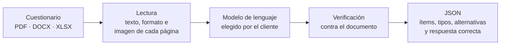

<div align="center">

# Extracción de cuestionarios

**Sube un cuestionario o una prueba en PDF, Word o Excel y recibe todas sus preguntas como JSON estructurado.**

Identifica cada ítem, su tipo, sus alternativas y, si el documento la marca, la respuesta correcta. Copia el contenido literal y no inventa nada.


<br />


[Pruébalo en línea](#pruébalo-en-línea) · [Inicio rápido](#inicio-rápido) · [Guías](#guías) · [Cómo funciona](guia/funcionamiento.md) · [API](guia/uso.md#integración-por-api) · [Supuestos](#supuestos)

</div>

---

## Pruébalo en línea

El servicio está publicado en Google Cloud:

| Qué | Dirección | Para quién |
|---|---|---|
| **Página de los clientes** | https://giunti-514722.web.app | Quien prueba: sube un cuestionario y ve el resultado |
| **Panel de administración** | https://giunti-514722.web.app/admin | El equipo: crea los accesos de prueba |
| **API** | https://giunti-backend-747240323866.us-central1.run.app/api/v1 | Integraciones (header `X-API-Key`) |
| **Documentación de la API** | https://giunti-backend-747240323866.us-central1.run.app/docs | Explorar y probar los endpoints desde el navegador |
| **Estado del servicio** | https://giunti-backend-747240323866.us-central1.run.app/health | Responde `{"status":"ok"}` si el backend está arriba |

**Para probarlo necesitas un enlace de invitación.** El acceso no es público: pídele uno al equipo. Con el enlace entras sin escribir ninguna clave. Si vas a integrarte por API, pide también la clave que aparece al crear la invitación.

- **Primera petición lenta:** el backend se apaga cuando nadie lo usa, así que la primera petición después de un rato tarda unos segundos más en responder.
- **Duración:** una extracción tarda entre 20 segundos y 3 minutos según el documento; los muy largos, más.
- **Límites:** cada acceso tiene un límite de extracciones por día y por minuto, que fija el administrador.

---

## Qué hace



Tiene dos páginas web y una API:

| | Para quién | Qué se hace ahí |
|---|---|---|
| **Página de los clientes** (`/`) | Los clientes invitados (por ejemplo, un colegio) | Subir el archivo, elegir el modelo y ver las preguntas, o descargar el JSON |
| **Panel de administración** (`/admin`) | El equipo que opera el servicio | Crear clientes, enviarles su enlace de invitación y fijar sus límites de uso |
| **API REST** (`/api/v1`) | Sistemas que se integran | Lo mismo que la página de los clientes, con una API key |

### Tipos de ítem que reconoce

| Tipo (`tipo`) | Ejemplo | Respuesta correcta |
|---|---|---|
| `escala_likert` | "Me preocupo demasiado" → Nunca · A veces · Siempre | No tiene |
| `seleccion_multiple` | "¿Qué número sigue? 2, 4, 8…" → A) 12 · B) 16 | `["B"]`, o varias: `["A", "D"]` |
| `verdadero_falso` | "El agua hierve a 100 °C" → V / F | `["V"]` |
| `emparejamiento` | Unir la columna 1–3 con la columna a–c | Pares: `["1-c", "2-a", "3-b"]` |
| `desarrollo` | "Describe una situación en que…" | No tiene |

La respuesta correcta solo se completa cuando el documento la indica: negrita, subrayado, resaltado, casilla marcada o una clave de respuestas. Si no hay evidencia, queda en `null`.

<details>
<summary><b>Ver un ejemplo de respuesta</b></summary>

```json
{
  "titulo": "Questionario di esempio",
  "idioma": "it",
  "total_items": 3,
  "items": [
    {
      "numero": 1,
      "enunciado": "Mi preoccupo eccessivamente per cose di poca importanza.",
      "tipo": "escala_likert",
      "alternativas": [
        { "valor": 0, "texto": "Mai" },
        { "valor": 1, "texto": "A volte" },
        { "valor": 2, "texto": "Spesso" },
        { "valor": 3, "texto": "Sempre" }
      ],
      "premisas": [],
      "respuesta_correcta": null
    },
    {
      "numero": 2,
      "enunciado": "Quale numero completa la serie: 2, 4, 8, 16, ...?",
      "tipo": "seleccion_multiple",
      "alternativas": [
        { "valor": "A", "texto": "18" },
        { "valor": "B", "texto": "24" },
        { "valor": "C", "texto": "32" }
      ],
      "premisas": [],
      "respuesta_correcta": ["C"]
    },
    {
      "numero": 3,
      "enunciado": "Descriva una situazione recente in cui si è sentito sotto pressione.",
      "tipo": "desarrollo",
      "alternativas": [],
      "premisas": [],
      "respuesta_correcta": null
    }
  ]
}
```

</details>

### Lo más destacado

- **Documentos largos:** los divide en partes de 8 páginas, las procesa en paralelo y las une sin duplicar preguntas.
- **Páginas escaneadas:** el modelo lee la imagen de la página cuando no hay texto.
- **Claves de respuestas al final:** si la clave ocupa varias páginas o es una imagen, hace una lectura extra solo para completar las respuestas que faltan.
- **Anti-invención:** comprueba que cada pregunta y alternativa aparezca en el documento y avisa de lo que no pudo verificar.
- **Tres modelos comparables:** Gemini, OpenAI y DeepSeek. El cliente elige uno y puede repetir con otro sin volver a subir el archivo.
- **Acceso por invitación:** el cliente entra con un enlace, sin contraseñas. Cada cliente tiene límites de uso diarios y por minuto.

## Inicio rápido

Necesitas **Docker** (con Compose) y una **API key de Gemini**. Si no tienes alguno de los dos, o es la primera vez que levantas el proyecto, sigue la [guía de instalación](guia/instalacion.md), que explica cada paso.

```bash
git clone <url-del-repositorio> giunti && cd giunti
cp backend/.env.example backend/.env
docker run --rm python:3.13-slim python -c "import secrets; print(secrets.token_urlsafe(48))"
# Edita backend/.env: API_KEY_PEPPER=<lo que imprimió el comando anterior> y GEMINI_API_KEY=<tu key>
docker compose up -d --build
docker compose exec backend python -m app.auth.create_key --name "Administración" --admin
```

El último comando imprime un enlace `http://localhost:8000/admin#clave=gk_…`. Ábrelo, crea tu primer cliente y prueba con un cuestionario.

## Guías

| Guía | Cuándo leerla |
|---|---|
| [Instalación](guia/instalacion.md) | Primera vez: levantar el servicio en tu computador, paso a paso y desde cero |
| [Despliegue en Google Cloud](guia/despliegue.md) | Publicar cambios en producción (Cloud Run + Firebase), volver atrás, configuración y secretos |
| [Servidor propio](guia/servidor-propio.md) | Instalarlo con Docker Compose en un servidor con dominio y HTTPS |
| [Uso](guia/uso.md) | Panel de administración, página de los clientes e integración por API |
| [Cómo funciona](guia/funcionamiento.md) | Arquitectura, flujos y diagramas: qué pasa desde que se sube el archivo |
| [Desarrollo](guia/desarrollo.md) | Modificar el código: devcontainer, comandos, estructura y controles de calidad |
| [Problemas frecuentes](guia/problemas.md) | Algo no funciona |

Cada proyecto tiene además su propio README: [backend](backend/README.md) y [evaluación](eval/README.md).

## Estructura del repositorio

```
giunti/
├── backend/              API en FastAPI: lectura de documentos, modelos, accesos (Python 3.13, uv)
├── frontend/             Página de los clientes y panel de administración (React + Vite + TypeScript)
├── eval/                 Cuestionarios sintéticos y medición de la calidad de la extracción
├── guia/                 Guías de instalación, despliegue, uso y funcionamiento
├── scripts/              Herramientas del repositorio (dependencias deprecadas)
├── .devcontainer/        Entorno de desarrollo, con las mismas versiones que producción
├── .github/workflows/    CI: controles de calidad y auditoría semanal de dependencias
├── docker-compose.yml    Backend + frontend (nginx) en un solo servidor
└── justfile              Comandos de todo el repositorio
```

## Supuestos

Cuando el enunciado admite más de una interpretación, se elige la más razonable, se registra aquí y se avanza. Cada supuesto indica qué era ambiguo, qué se asumió y por qué.

<details>
<summary><b>Entrada</b> (S1–S5, S20)</summary>

| # | Ambigüedad | Supuesto | Por qué |
|---|---|---|---|
| S1 | ¿Uno o varios archivos por petición? | **Un archivo por petición.** | El enunciado habla de subir un archivo. Varios archivos se cubren con varias peticiones. |
| S2 | ¿Qué versiones de Word y Excel? | Solo `.docx` y `.xlsx`. `.doc`, `.xls` y los formatos con macros (`.docm`, `.xlsm`) se rechazan con `UNSUPPORTED_FORMAT`. | El enunciado nombra `.docx` y `.xlsx`; los formatos antiguos y con macros agregan riesgo sin beneficio. |
| S3 | ¿Puede un archivo traer varios cuestionarios? | Cada archivo se trata como **un solo cuestionario**. Si tiene secciones, todos sus ítems van en la misma lista. | El esquema de salida tiene un solo `titulo` y una sola lista de `items`. |
| S4 | ¿La clave de respuestas puede venir en otro archivo? | Solo se usa la información **del mismo archivo** (marcas de formato o clave incluida en él). | Con un archivo por petición no hay forma de asociar dos archivos. |
| S5 | ¿Qué imágenes se procesan? | Solo las de **PDF y Word**, y solo para leer el texto de preguntas que vienen como imagen o para ubicar las figuras de una pregunta. Las de Excel se ignoran. | Indicación del equipo. |
| S20 | ¿Qué hacer con las hojas ocultas de un Excel? | Se **incluyen**, marcadas como ocultas. Las hojas vacías se omiten. | A veces la clave de respuestas está en una hoja oculta; marcarla deja al modelo decidir con esa información. |

</details>

<details>
<summary><b>Salida</b> (S6–S17, S22)</summary>

| # | Ambigüedad | Supuesto | Por qué |
|---|---|---|---|
| S6 | `respuesta_correcta` aparece como texto en el ejemplo, pero un ítem puede tener varias respuestas correctas. | Es una **lista** (`["C"]`, `["A", "D"]`) o `null`. | Cubre selección múltiple con varias correctas, verdadero/falso y emparejamiento con un solo tipo de dato. |
| S7 | El esquema no prevé el emparejamiento (dos columnas). | Un ítem por ejercicio con el campo extra **`premisas`** (columna A); `alternativas` es la columna B; la respuesta son pares: `["1-c", "2-a"]`. En los demás tipos `premisas` es `[]`. | Mantiene la numeración del documento y evita que el modelo reorganice el contenido. |
| S8 | ¿Cómo representar alternativas que son figuras ("¿qué figura falta?")? | `texto: null`; `valor` lleva la etiqueta (A, B, C…). | No se pide al modelo describir imágenes, que es donde más inventa. |
| S9 | ¿`respuesta_correcta` cuando el documento no la indica? | `null`. Solo se llena con evidencia en el documento (negrita, subrayado, resaltado, casilla marcada o clave de respuestas). | Evitar respuestas inventadas. |
| S10 | ¿Qué hacer si no hay título? | `titulo: null`. | No inventar contenido. |
| S11 | ¿Formato de `idioma`? | Código ISO 639-1 (`it`, `es`, `en`…), como en el ejemplo. Se detectan al menos italiano, español e inglés; otros idiomas se devuelven con su código. | Es el formato del ejemplo y un estándar. |
| S12 | `total_items` | Se calcula en código como la cantidad de ítems. | No depender del modelo para un dato derivable. |
| S13 | ¿Qué es `numero`? | El número que muestra el documento. Si no hay numeración, o se repite entre secciones, se numera de forma correlativa desde 1. | Respeta el documento y garantiza números únicos. |
| S14 | Valores de la escala Likert | Si el documento muestra valores numéricos, se usan esos. Si no, enteros consecutivos desde 0 en el orden mostrado. | Es lo que muestra el ejemplo (`Mai` = 0 … `Sempre` = 3). |
| S15 | Valores de selección múltiple sin letras | Si el documento no rotula las opciones, se usan A, B, C… en el orden mostrado. | Da una referencia estable para `respuesta_correcta`. |
| S16 | Verdadero/falso sin opciones escritas | Dos alternativas `V` / `F`, con el texto en el idioma del documento (por ejemplo, `Vero` / `Falso`). | El tipo implica esas dos opciones aunque el documento no las escriba. |
| S17 | Textos con errores de extracción (palabras cortadas por guion al final de línea) | Se reconstruyen las palabras cortadas, pero el contenido se copia **literal**: sin traducir, corregir ni resumir. | Fidelidad al documento original. |
| S22 | ¿Qué hacer si la clave de respuestas ocupa varias páginas, está solo como imagen o lejos de las preguntas? | Se busca y se usa igual: los ítems de selección, verdadero/falso o emparejamiento que quedan sin respuesta se completan con **una lectura extra de las páginas de la clave**. Si la clave no da la respuesta de un ítem o no se puede asociar con seguridad (por ejemplo, dos exámenes que reinician la numeración), queda `null` y se informa en `X-Extraction-Warnings`. Nunca se cambia una respuesta ya encontrada. | La clave al final, en una tabla de varias páginas, es el formato habitual de las pruebas estandarizadas; el usuario no puede adaptar el documento a la API. |

</details>

<details>
<summary><b>Errores, acceso, modelos y despliegue</b> (S18, S19, S21, S23, S24)</summary>

| # | Ambigüedad | Supuesto | Por qué |
|---|---|---|---|
| S18 | ¿Cómo informar los errores? | JSON `{"error": {"code", "message", "request_id"}}` con códigos estables en inglés y el código HTTP correspondiente (por ejemplo, 422 `NO_ITEMS` si no se detectan ítems, 415 `UNSUPPORTED_FORMAT` si el formato no es válido). | El cliente puede reaccionar al código sin interpretar textos, y el `request_id` permite rastrear el caso en los logs. |
| S19 | El módulo de autenticación no define usuarios. | Acceso con **API key** por cliente, tanto para el frontend como para integraciones por API. | Los clientes de prueba no necesitan registro, roles ni historial. |
| S24 | ¿Puede el cliente elegir cuánto razona el modelo? | Sí: modo **`fast`** (rápido, por defecto) o **`precise`** (preciso), por petición. Si el modelo elegido no ofrece el modo rápido, se usa el preciso, y el header `X-LLM-Mode` informa el modo real. | El razonamiento interno domina el tiempo y el costo: en Saber 11 Inglés el modo rápido tardó 8 veces menos y generó 8,6 veces menos tokens, con la misma precisión. Los documentos difíciles pueden necesitar el preciso, y solo quien los conoce sabe cuándo. |
| S21 | ¿Qué modelo se usa si el cliente no elige uno? | El `default_model` del catálogo (Gemini Flash); si su proveedor no tiene API key, el primer modelo habilitado. Nunca hay fallback: si el modelo falla, se devuelve el error. | Las integraciones por API no quedan obligadas a enviar el modelo, y el cliente siempre sabe qué modelo produjo el resultado (header `X-LLM-Model`). |
| S23 | ¿Cómo se despliega en un servidor y con qué configuración? | **Docker Compose en un solo servidor, siempre en modo producción**, detrás de un proxy inverso con HTTPS que el equipo pone (Caddy recomendado). El puerto de la aplicación puede limitarse a la propia máquina (`APP_BIND_ADDRESS=127.0.0.1`). | La extracción es síncrona y tarda minutos: un solo servidor sin límite de tiempo por petición es lo más simple que funciona. Forzar producción en el compose evita desplegar por descuido con un secreto de ejemplo. El despliegue en la nube queda pendiente. |

</details>
