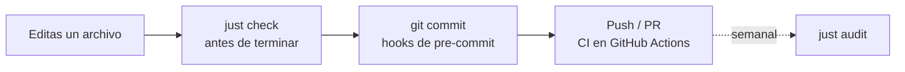

# Desarrollo

[← Volver al README](../README.md)

Cómo preparar el entorno para modificar el código, los comandos del día a día y los controles que debe pasar cada cambio.

## Entorno con devcontainer (recomendado)

El devcontainer trae exactamente las versiones de producción: Python 3.13, uv 0.12.5, Node 22, LibreOffice, `just` y `pre-commit`.

**Necesitas:** Git, Docker y [VS Code](https://code.visualstudio.com/) con la extensión [Dev Containers](https://marketplace.visualstudio.com/items?itemName=ms-vscode-remote.remote-containers).

1. Clona el repositorio y ábrelo en VS Code:
   ```bash
   git clone <url-del-repositorio> giunti
   code giunti
   ```
2. Ejecuta **"Dev Containers: Reopen in Container"** (Ctrl+Shift+P o Cmd+Shift+P). La primera vez construye el entorno e instala las dependencias con `just setup`: tarda varios minutos.
3. Configura el backend como en el [paso 4 de la instalación](instalacion.md#4-configura-el-backend). Dentro del devcontainer puedes generar el secreto con Python directamente:
   ```bash
   cp backend/.env.example backend/.env
   python3 -c "import secrets; print(secrets.token_urlsafe(48))"
   ```
4. Crea el primer administrador (solo una vez):
   ```bash
   just backend::create-admin    # imprime http://localhost:5173/admin#clave=gk_…
   ```
5. Levanta el backend y el frontend, cada uno en su terminal:
   ```bash
   just backend::dev             # API en http://localhost:8080, con recarga automática (docs en /docs)
   just frontend::dev            # página en http://localhost:5173 (reenvía /api al backend)
   ```
6. Abre el enlace del paso 4.

Si cambias `backend/.env`, detén `just backend::dev` (Ctrl+C) y vuelve a ejecutarlo.

**Sin devcontainer:** instala Python 3.13, [uv](https://docs.astral.sh/uv/) 0.12.5, Node 22, LibreOffice y [just](https://just.systems/) 1.58, ejecuta `just setup` y sigue desde el paso 3.

## Desarrollo frente a Docker Compose

| | Desarrollo (`just …::dev`) | Docker Compose |
|---|---|---|
| Página | http://localhost:5173 (Vite, recarga al guardar) | http://localhost:8000 (nginx) |
| API | http://localhost:8080 | Misma dirección de la página, bajo `/api` |
| `APP_ENV` | El de `backend/.env` (`development`) | Siempre `production` |
| `PUBLIC_APP_URL` | El de `backend/.env` | El del `.env` de la raíz (por defecto http://localhost:8000) |
| Base de datos | `backend/data/giunti.db` | Volumen `backend-data` |

Son bases de datos distintas: un administrador creado en una no existe en la otra.

## Comandos

Cada proyecto (`backend/`, `frontend/`, `eval/`) tiene su propio `justfile` y funciona solo (`cd backend && just check`). El `justfile` de la raíz los carga como módulos. `just` sin argumentos lista todos los comandos.

| Comando (desde la raíz) | Para qué |
|---|---|
| `just setup` | Instala las dependencias de todos los proyectos y los hooks de git |
| `just backend::dev` / `just frontend::dev` | Servidores de desarrollo (8080 / 5173) |
| `just backend::create-admin` | Crea un administrador e imprime su enlace |
| `just backend::create-key "Nombre" [diario] [por_minuto]` | Crea un cliente desde la terminal (el panel hace lo mismo) |
| `just backend::delete-key <id>` | Elimina un cliente o un administrador y su clave (no se puede deshacer) |
| `just fmt` / `just fix` | Formatea / aplica todas las correcciones automáticas |
| `just check` | **Todos los controles de todos los proyectos** |
| `just backend::check`, `just frontend::check`, `just eval::check` | Los controles de un proyecto |
| `just backend::test [args]` | Solo los tests del backend (los args van a pytest) |
| `just audit` / `just outdated` | Dependencias vulnerables o deprecadas / actualizaciones disponibles |
| `just up` / `just down` | Docker Compose (`docker compose up --build` / `down`) |

## Controles de calidad



`just check` corre, en cada proyecto:

| | Backend y eval (Python) | Frontend (TypeScript) |
|---|---|---|
| Formato | `ruff format` (100 columnas) | Prettier (100 columnas) |
| Lint | `ruff check` (incluye el orden de imports) | ESLint `strictTypeChecked` + accesibilidad |
| Tipos | `mypy --strict` | `tsc` estricto |
| Arquitectura | `import-linter` (límites entre paquetes) | |
| Tests | pytest | Vitest + Testing Library |
| Build | | `vite build` + presupuesto de tamaño (120 KB gzip) |

Los hooks de pre-commit corren los mismos controles en cada commit (no se saltan con `--no-verify`), y CI los repite en cada push y PR, con LibreOffice instalado.

## Convenciones

- **Idioma:** el código va en inglés (nombres, comentarios, logs, tests, commits). Van en español los nombres de campo del JSON (`titulo`, `enunciado`…), que fija el enunciado; los textos de la interfaz, y los README y las guías.
- **Comentarios:** solo docstrings y comentarios que expliquen un **por qué** no evidente.
- **Tipos estrictos:** nada de `Any` implícito en Python ni de `any` en TypeScript.
- **Límites:** solo `app.llm` habla con los proveedores de modelos, y la configuración se lee solo desde `app.core.config.Settings`.
- **Privacidad:** nunca se registra el contenido de los documentos ni las API keys.
- **Dependencias:** se agregan con `uv add` o `npm install`, y se versiona el lockfile. Antes hay que verificar que estén mantenidas, que tengan tipos y que su licencia sea compatible (nada GPL/AGPL en el backend).
- **Supuestos:** cuando un requisito es ambiguo, se elige la opción más razonable y se registra en la sección [Supuestos del README](../README.md#supuestos).

## Pruebas y evaluación

- **Tests** (`backend/tests/base` para lo reutilizable, `backend/tests/extraction` para lo específico): las llamadas a los modelos **siempre se simulan**, así que los tests nunca usan la red ni gastan cuota.
- **Evaluación de calidad** (`eval/`): genera cuestionarios sintéticos en DOCX, PDF, PDF escaneado y XLSX con la respuesta conocida de antemano, los procesa con la API real y mide ítems encontrados o inventados, tipos, fidelidad del texto y respuestas correctas. Ver el [README de evaluación](../eval/README.md).

Para entender qué hace cada paquete antes de cambiarlo, lee [Cómo funciona](funcionamiento.md#mapa-del-código).
