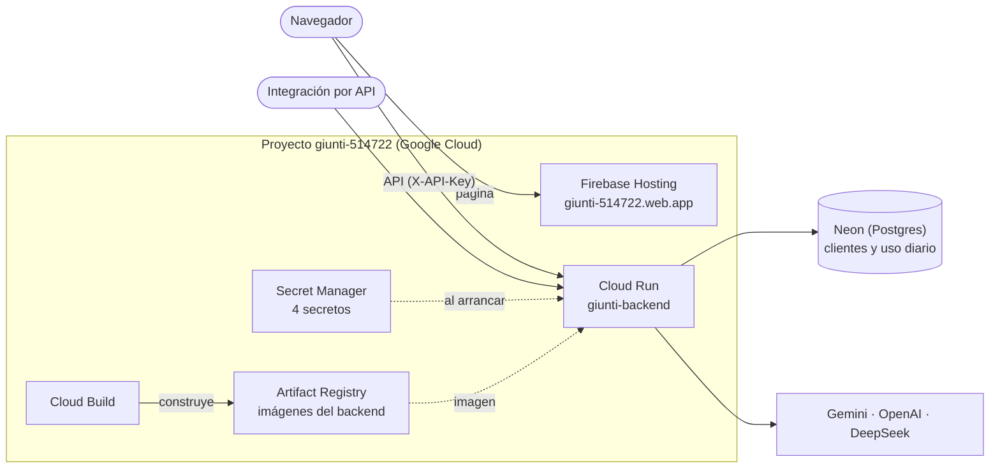
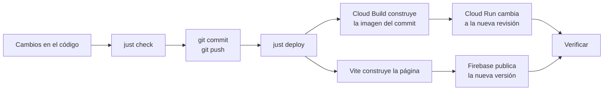

# Despliegue en Google Cloud

[← Volver al README](../README.md) · [Servidor propio con Docker Compose](servidor-propio.md)

Cómo está publicada la aplicación, cómo se publica un cambio después de subirlo a GitHub, cómo volver atrás y cómo cambiar la configuración y los secretos.

**Contenido:** [Cómo está montado](#cómo-está-montado) · [Preparar tu equipo](#preparar-tu-equipo-una-sola-vez) · [Publicar cambios](#publicar-cambios) · [Volver atrás](#volver-a-la-versión-anterior) · [Configuración y secretos](#configuración-y-secretos) · [Administradores](#administradores-en-producción) · [Logs y costos](#logs-y-costos) · [Montarlo desde cero](#montarlo-desde-cero)

## Cómo está montado



| Pieza | Dónde | Qué guarda o hace |
|---|---|---|
| **Página web** | Firebase Hosting, sitio `giunti-514722` → https://giunti-514722.web.app | Los archivos estáticos del frontend (página de los clientes y `/admin`) |
| **API** | Cloud Run, servicio `giunti-backend` en `us-central1` → https://giunti-backend-747240323866.us-central1.run.app | El backend: 2 vCPU, 2 GB, hasta 15 minutos por petición, de 0 a 1 instancia |
| **Imagen del backend** | Artifact Registry, repositorio `giunti` | Solo la imagen desplegada (`backend:<commit>`); las anteriores se borran al desplegar |
| **Secretos** | Secret Manager | `gemini-api-key`, `llm-api-keys`, `api-key-pepper` y `database-url`. Solo los lee la cuenta de servicio `giunti-backend` |
| **Base de datos** | [Neon](https://console.neon.tech), proyecto `floral-wave-85394410` | Clientes, hashes de sus claves y uso diario. Los documentos nunca se guardan |

- **Pagas solo lo que usas:** Cloud Run se apaga cuando nadie lo usa, así que la primera petición después de un rato tarda unos segundos más.
- **El código vive en GitHub**, pero **subir cambios a GitHub no actualiza producción por sí solo**: hay que desplegarlos con los comandos de esta guía.

## Preparar tu equipo (una sola vez)

Se despliega desde el devcontainer, que ya trae `just`, Node y Python. Solo falta la CLI de Google Cloud.

1. **Pide acceso al proyecto.** El dueño debe darte el rol **Propietario** del proyecto `giunti-514722` en [IAM](https://console.cloud.google.com/iam-admin/iam?project=giunti-514722) (*Otorgar acceso*).
2. **Instala `gcloud`** en una terminal del devcontainer. La descarga pesa unos 150 MB y no muestra nada mientras avanza: espera a que vuelva el prompt.
   ```bash
   curl -fsSL https://dl.google.com/dl/cloudsdk/channels/rapid/downloads/google-cloud-cli-linux-x86_64.tar.gz | tar -xz -C ~
   echo 'export PATH="$HOME/google-cloud-sdk/bin:$PATH"' >> ~/.bashrc && source ~/.bashrc
   ```
   Fuera del devcontainer, sigue la [instalación oficial](https://cloud.google.com/sdk/docs/install).
3. **Inicia sesión** con la cuenta que tiene acceso al proyecto. El comando muestra un enlace; el código que te da Google se pega **en la terminal**, nunca en un chat ni en un documento.
   ```bash
   gcloud auth login --no-launch-browser
   gcloud config set project giunti-514722
   ```
4. **Comprueba** que todo responde:
   ```bash
   just deploy-status
   ```
   ```
   REVISION                  IMAGE            DEPLOYED_BY
   giunti-backend-00003-g6v  backend:b36e656  …
   API: https://giunti-backend-747240323866.us-central1.run.app
   Web: https://giunti-514722.web.app
   ```

> Si recreas el devcontainer, se borra la carpeta de inicio y hay que repetir los pasos 2 y 3.

## Publicar cambios

### El caso típico: "subí cambios a GitHub, ¿cómo los publico?"



Desde la raíz del repositorio:

```bash
git pull                  # trae lo último de GitHub (si otra persona subió cambios)
just check                # formato, lint, tipos, tests y build: no despliegues si falla
just deploy               # backend y frontend, desde el commit actual
```

`just deploy` muestra cada etapa:

```
==> Building us-central1-docker.pkg.dev/giunti-514722/giunti/backend:3f2a9c1 in Cloud Build
==> Rolling out on Cloud Run (giunti-backend)
==> Health: {"status":"ok"}
==> Keeping only the deployed image (older ones cost storage and are not used)
==> Building the frontend for https://giunti-backend-747240323866.us-central1.run.app
==> Publishing on Firebase Hosting (giunti-514722)
4 files (3 new) published on https://giunti-514722.web.app
```

**Tarda unos 4 minutos:** 2 minutos construyendo la imagen, 1 a 2 minutos cambiando de revisión y unos segundos publicando la página. La imagen se construye en los servidores de Google, así que tu conexión solo sube el código fuente (menos de 1 MB).

**No hay corte de servicio:**
- Cloud Run sigue atendiendo con la versión anterior hasta que la nueva arranca, y recién entonces cambia el tráfico.
- Firebase cambia todos los archivos de una vez.
- Las extracciones que estaban en curso terminan en la versión anterior.

### Qué desplegar según lo que cambió

| Cambiaste | Comando | Por qué |
|---|---|---|
| Solo `backend/` (código Python, `Dockerfile`, `llm_catalog.toml`, dependencias) | `just deploy-backend` | La página no cambia |
| Solo `frontend/` (páginas, textos, estilos, `firebase.json`) | `just deploy-frontend` | El backend no cambia; tarda segundos |
| Los dos, o no estás seguro | `just deploy` | Despliega todo; repetir lo que no cambió no hace daño |
| Solo `README.md`, `guia/` o `eval/` | Nada | No forman parte de lo publicado |
| Un valor de configuración o un secreto | Ver [Configuración y secretos](#configuración-y-secretos) | No requiere desplegar código |

### Lo que comprueba antes de desplegar

Para que siempre se sepa qué código está en producción, `just deploy*` se niega a desplegar si:

- hay **cambios sin commitear** en `backend/`, `frontend/` o `scripts/` (*"commit them before deploying"*);
- el commit **no está en GitHub** (*"run 'git push' before deploying"*);
- **no encuentra `gcloud`** (ver [Preparar tu equipo](#preparar-tu-equipo-una-sola-vez)).

La imagen queda etiquetada con el commit (`backend:3f2a9c1`): `just deploy-status` muestra cuál está corriendo, y en GitHub se ve qué contiene.

### Verificar después de desplegar

1. `just deploy-status`: la columna `IMAGE` muestra el commit recién desplegado.
2. https://giunti-backend-747240323866.us-central1.run.app/health responde `{"status":"ok"}`.
3. Abre https://giunti-514722.web.app. Si cambiaste el frontend y no ves el cambio, recarga una vez: la página nunca queda guardada en el navegador, solo los archivos que cambian de nombre en cada versión.
4. Si el cambio toca la extracción, prueba con un cuestionario corto.

### Cambios en la base de datos

Al arrancar, el backend **crea solo las tablas nuevas**. Las columnas nuevas, renombradas o eliminadas en tablas existentes **no se aplican solas**, porque no hay migraciones automáticas. Antes de desplegar un cambio así:

1. Aplica el cambio en el [editor SQL de Neon](https://console.neon.tech) (por ejemplo, `ALTER TABLE clients ADD COLUMN …`).
2. Recién después despliega el backend.

## Volver a la versión anterior

**Lo recomendado** es deshacer el cambio en git y desplegar de nuevo. Así producción siempre corresponde a un commit de GitHub:

```bash
git revert <commit>       # crea un commit que deshace el cambio
git push
just deploy
```

Es la única forma para el backend: para no pagar almacenamiento, `just deploy-backend` **conserva solo la imagen desplegada** y borra las anteriores. Las revisiones viejas de Cloud Run siguen en la lista, pero ya no tienen imagen y no pueden volver a recibir tráfico. Volver atrás tarda lo mismo que un despliegue, unos 4 minutos.

**Para la página:** en la [consola de Firebase](https://console.firebase.google.com/project/giunti-514722/hosting/sites) → *Hosting* → historial de versiones, elige la anterior y pulsa *Revertir*.

Volver atrás el código **no deshace cambios en la base de datos**: las tablas nuevas quedan, sin afectar a la versión anterior.

## Configuración y secretos

**Ver la configuración actual** (sin mostrar los secretos):

```bash
gcloud run services describe giunti-backend --region us-central1 --format yaml | grep -A80 "env:"
```

**Cambiar un valor que no es secreto** (cualquier variable de [backend/.env.example](../backend/.env.example), salvo los secretos). Se aplica en 1 o 2 minutos, sin desplegar código:

```bash
gcloud run services update giunti-backend --region us-central1 --update-env-vars LOG_LEVEL=DEBUG
```

Si cambias `CORS_ORIGINS` o `PUBLIC_APP_URL`, cámbialos también en tu `backend/.env.production` (ver [Administradores](#administradores-en-producción)).

**Cambiar un secreto** (por ejemplo, una key de Gemini nueva). `read -rs` lo pide sin mostrarlo ni guardarlo en el historial de la terminal:

```bash
read -rs VALOR && printf '%s' "$VALOR" | gcloud secrets versions add gemini-api-key --data-file=- && unset VALOR
gcloud run services update giunti-backend --region us-central1 --update-secrets GEMINI_API_KEY=gemini-api-key:latest
```

El segundo comando crea una revisión que lee la versión nueva del secreto.

| Secreto | Variable | Contenido |
|---|---|---|
| `gemini-api-key` | `GEMINI_API_KEY` | Key de Gemini (obligatoria) |
| `llm-api-keys` | `LLM_API_KEYS` | JSON con las keys de los demás proveedores: `{"openai": "sk-…", "deepseek": "sk-…"}`. Un modelo aparece solo si su proveedor tiene key |
| `api-key-pepper` | `API_KEY_PEPPER` | Protege las claves de los clientes. **No lo cambies:** invalida todas las claves y hay que crear un administrador e invitaciones nuevas |
| `database-url` | `DATABASE_URL` | Conexión a Neon (`postgresql+psycopg://…`) |

**El límite de gasto de Gemini** se controla en [ai.studio/spend](https://ai.studio/spend), en el proyecto de AI Studio de la key. Si se alcanza, las extracciones fallan con "Se agotó la cuota del modelo", y el backend pausa ese modelo 15 minutos. Después de subir el límite, puedes reiniciar el backend para no esperar:

```bash
gcloud run services update giunti-backend --region us-central1 --update-env-vars RESTARTED_AT=$(date -u +%Y%m%dT%H%M%S)
```

## Administradores en producción

Los administradores se crean y eliminan desde tu terminal, contra la base de producción. Para eso se usa un archivo local con la configuración de producción, `backend/.env.production`. Git lo ignora y **no se comparte**.

```bash
cd backend
uv run python -m app.auth.create_key --name "Administración" --admin --env-file .env.production
uv run python -m app.auth.delete_client administracion --env-file .env.production
```

El enlace que imprime el primer comando ya apunta a https://giunti-514722.web.app/admin. Guárdalo en un gestor de contraseñas.

**Si no tienes `backend/.env.production`**, créalo a partir de `backend/.env.example` con `APP_ENV=production`, la dirección de la página en `PUBLIC_APP_URL` y `CORS_ORIGINS`, y estos dos valores, sacados de Secret Manager sin mostrarlos en pantalla:

```bash
cd backend && cp .env.example .env.production && chmod 600 .env.production
sed -i 's|^APP_ENV=.*|APP_ENV=production|; s|^PUBLIC_APP_URL=.*|PUBLIC_APP_URL=https://giunti-514722.web.app|; s|^CORS_ORIGINS=.*|CORS_ORIGINS=["https://giunti-514722.web.app","https://giunti-514722.firebaseapp.com"]|; /^API_KEY_PEPPER=/d' .env.production
printf 'API_KEY_PEPPER=%s\n' "$(gcloud secrets versions access latest --secret api-key-pepper)" >> .env.production
printf 'DATABASE_URL=%s\n' "$(gcloud secrets versions access latest --secret database-url)" >> .env.production
```

## Logs y costos

| Para | Dónde |
|---|---|
| Logs del backend | `gcloud run services logs read giunti-backend --region us-central1 --limit 50`, o la pestaña *Registros* de [Cloud Run](https://console.cloud.google.com/run/detail/us-central1/giunti-backend/logs?project=giunti-514722) |
| Buscar un error que vio un usuario | Cada error muestra un *código de solicitud*: búscalo en los logs |
| Revisiones y tráfico | [Cloud Run → giunti-backend → Revisiones](https://console.cloud.google.com/run/detail/us-central1/giunti-backend/revisions?project=giunti-514722) |
| Gasto | [Facturación del proyecto](https://console.cloud.google.com/billing/linkedaccount?project=giunti-514722) y [ai.studio/spend](https://ai.studio/spend) para Gemini |

| Servicio | Costo esperado |
|---|---|
| Cloud Run | Gratis dentro de la cuota mensual (≈300 extracciones de 5 minutos). El máximo de 1 instancia acota el gasto |
| Cloud Build | Gratis hasta 2.500 minutos de construcción al mes; cada despliegue usa ≈2 |
| Firebase Hosting, Secret Manager, Neon | Gratis en el uso actual |
| Artifact Registry | Gratis: se guarda una sola imagen (≈490 MB), dentro de los 0,5 GB incluidos |
| Gemini y demás modelos | Por uso, aparte, en la cuenta de cada proveedor |

## Montarlo desde cero

<details>
<summary><b>Pasos para recrear la infraestructura en otro proyecto</b> (no hace falta para publicar cambios)</summary>

Con un proyecto con facturación activa y `gcloud` apuntando a él (`PROJECT`, `REGION` y `NUMBER` = número del proyecto):

```bash
gcloud services enable run.googleapis.com artifactregistry.googleapis.com secretmanager.googleapis.com \
  cloudbuild.googleapis.com firebase.googleapis.com firebasehosting.googleapis.com
gcloud artifacts repositories create giunti --repository-format=docker --location=$REGION

# Secretos (uno por uno, sin mostrarlos) y una cuenta de servicio que solo puede leerlos
for s in gemini-api-key llm-api-keys api-key-pepper database-url; do
  read -rsp "$s: " V && printf '%s' "$V" | gcloud secrets create $s --data-file=-; echo
done
gcloud iam service-accounts create giunti-backend
for s in gemini-api-key llm-api-keys api-key-pepper database-url; do
  gcloud secrets add-iam-policy-binding $s --role roles/secretmanager.secretAccessor \
    --member serviceAccount:giunti-backend@$PROJECT.iam.gserviceaccount.com
done

# Backend (la primera vez con toda la configuración; después basta just deploy-backend)
cat > /tmp/giunti-env.yaml <<EOF
APP_ENV: production
PUBLIC_APP_URL: https://$PROJECT.web.app
CORS_ORIGINS: '["https://$PROJECT.web.app","https://$PROJECT.firebaseapp.com"]'
EOF
gcloud builds submit backend --tag $REGION-docker.pkg.dev/$PROJECT/giunti/backend:inicial --region $REGION
gcloud run deploy giunti-backend --image $REGION-docker.pkg.dev/$PROJECT/giunti/backend:inicial \
  --region $REGION --service-account giunti-backend@$PROJECT.iam.gserviceaccount.com \
  --allow-unauthenticated --cpu 2 --memory 2Gi --timeout 900 --concurrency 10 \
  --min-instances 0 --max-instances 1 --cpu-boost --env-vars-file /tmp/giunti-env.yaml \
  --set-secrets GEMINI_API_KEY=gemini-api-key:latest,LLM_API_KEYS=llm-api-keys:latest,API_KEY_PEPPER=api-key-pepper:latest,DATABASE_URL=database-url:latest

# Firebase en el proyecto (crea el sitio https://$PROJECT.web.app)
curl -X POST -H "Authorization: Bearer $(gcloud auth print-access-token)" -H "X-Goog-User-Project: $PROJECT" \
  https://firebase.googleapis.com/v1beta1/projects/$PROJECT:addFirebase
```

Después:
1. Cambia en [frontend/firebase.json](../frontend/firebase.json) la URL del backend dentro de `connect-src` por `https://giunti-backend-$NUMBER.$REGION.run.app`.
2. Cambia el proyecto en [frontend/.firebaserc](../frontend/.firebaserc).
3. Despliega con `GCP_PROJECT=$PROJECT GCP_REGION=$REGION just deploy-frontend`.

La base de datos es un proyecto de [Neon](https://neon.tech) (plan gratuito). Su cadena de conexión, con el prefijo `postgresql+psycopg://`, va en el secreto `database-url`. Las tablas se crean solas al arrancar.

</details>

## Siguiente paso posible: despliegue automático

Hoy cada despliegue se lanza a mano con `just deploy`. Se puede configurar **GitHub Actions** para que cada push a `master` que pase los controles de CI se despliegue solo. Requiere crear en Google Cloud una identidad para GitHub (*Workload Identity Federation*, sin guardar claves en GitHub) y un workflow nuevo.
