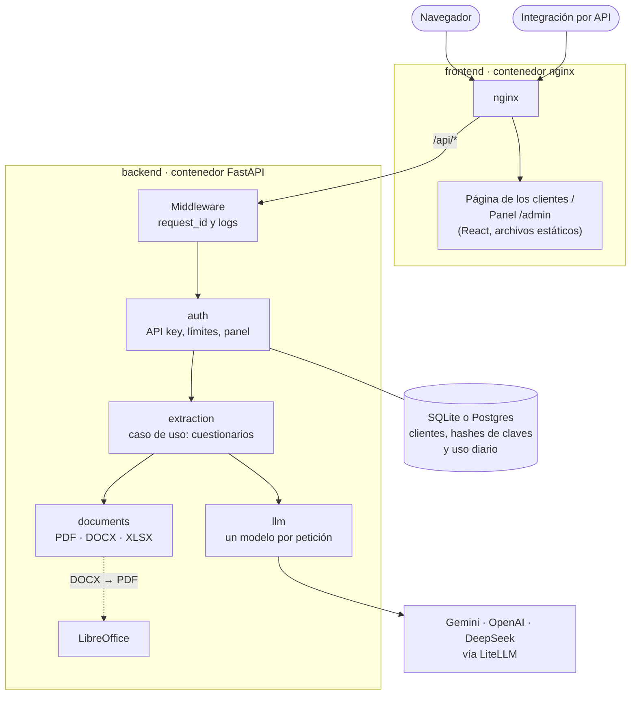
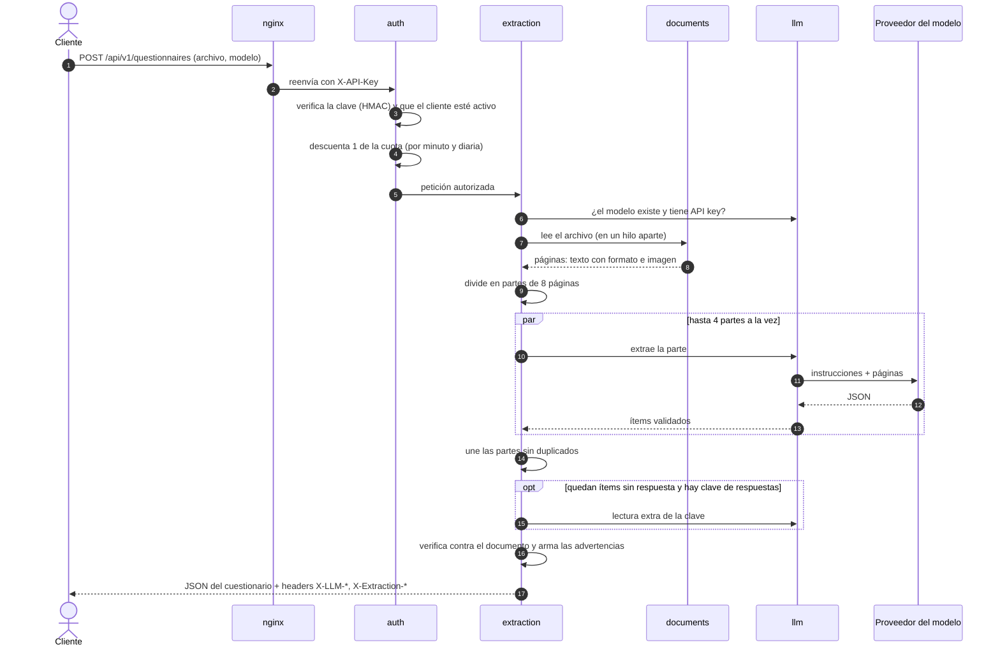
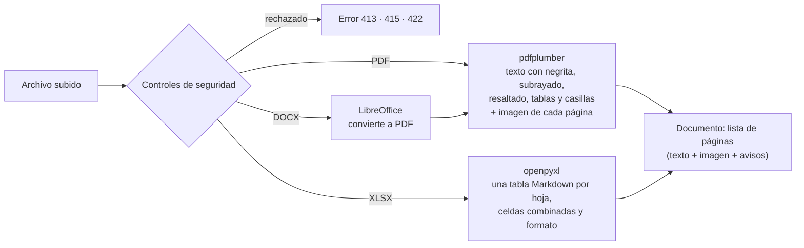
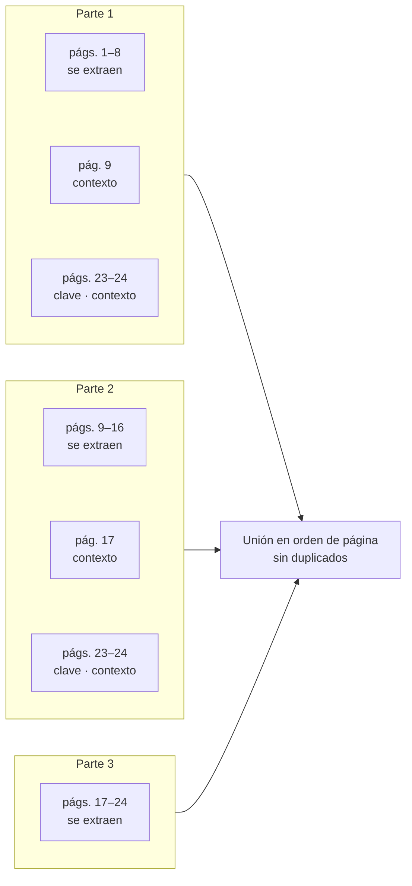
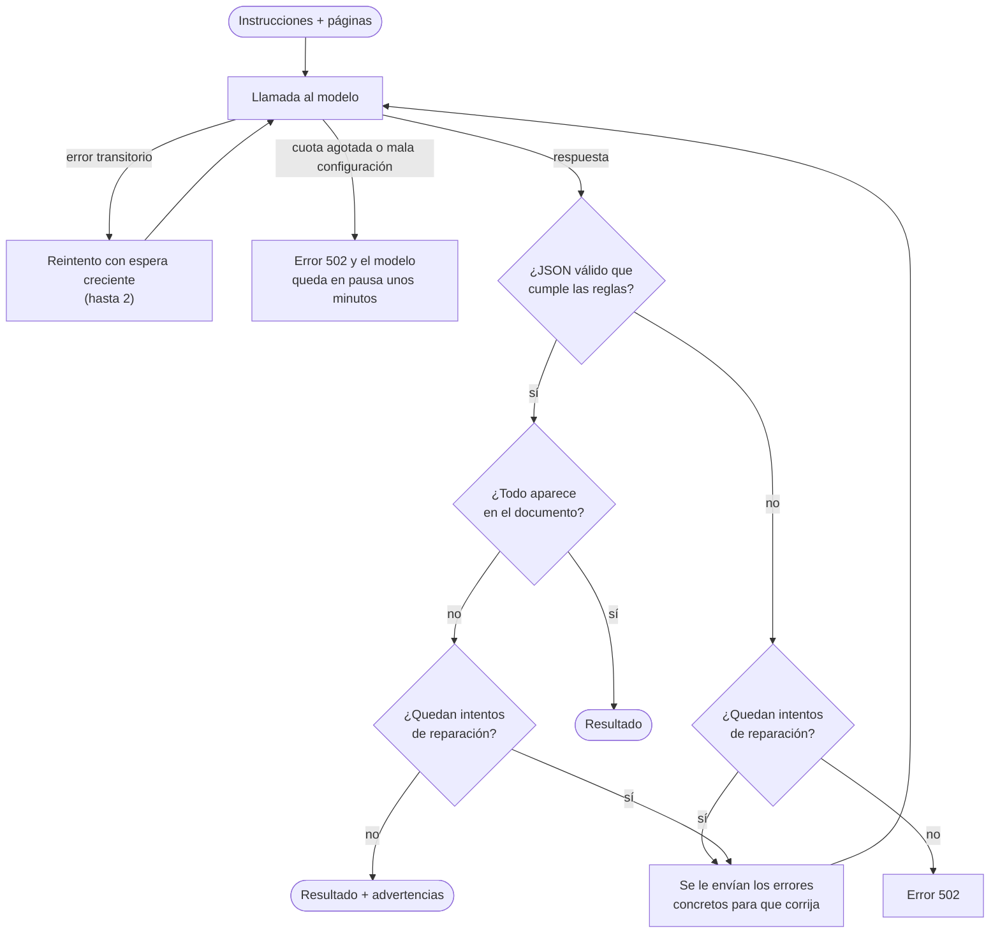
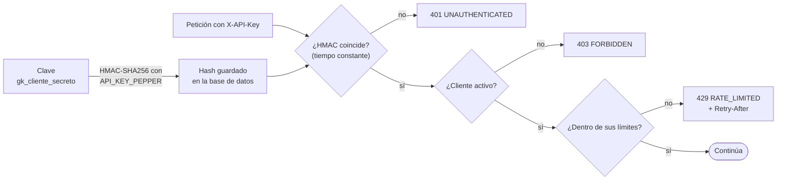

# Cómo funciona

[← Volver al README](../README.md)

Qué pasa desde que alguien sube un cuestionario hasta que recibe el JSON, y cómo está organizado el código.

**Contenido:** [Arquitectura](#arquitectura) · [El viaje de una petición](#el-viaje-de-una-petición) · [Lectura del documento](#1-lectura-del-documento) · [Documentos largos](#2-documentos-largos-extracción-por-partes) · [Llamada al modelo](#3-una-llamada-al-modelo) · [Clave de respuestas](#4-la-clave-de-respuestas) · [Verificación](#5-verificación-contra-el-documento) · [Accesos y seguridad](#accesos-y-seguridad) · [Modelos](#modelos-de-lenguaje) · [Mapa del código](#mapa-del-código)

## Arquitectura

- **frontend:** dos páginas estáticas (React + Vite) servidas por nginx. nginx también reenvía `/api` al backend, así la web y la API comparten dirección y no hace falta CORS.
- **backend:** una API FastAPI sin estado, salvo la base de clientes. Los documentos se procesan en memoria y se descartan.
- **Proveedores de modelos:** se llaman a través de [LiteLLM](https://github.com/BerriAI/litellm), con una interfaz común para todos.

## El viaje de una petición

Si algo falla en cualquier paso, la respuesta es un error con formato único (`{"error": {"code", "message", …}}`). Nunca se devuelve un cuestionario a medias que parezca completo: si una parte falla, se cancelan las demás y falla la petición.

### 1. Lectura del documento

- **Controles de seguridad:**
  - tamaño máximo (20 MB) y páginas (60);
  - tamaño descomprimido de DOCX/XLSX, contra *zip bombs*;
  - rechazo de formatos antiguos (`.doc`, `.xls`), con macros o cifrados;
  - el tipo real del archivo debe coincidir con su extensión.
- **El formato importa:** la negrita, el subrayado, el resaltado y las casillas marcadas son la principal evidencia de la respuesta correcta, por eso se conservan como marcas en el texto.
- **Word pasa por PDF:** convertirlo con LibreOffice hace visibles la numeración automática, los cuadros de texto y las ecuaciones, sin código específico para cada caso.
- **Páginas escaneadas:** no tienen texto; se marcan y el modelo las lee desde la imagen.

### 2. Documentos largos: extracción por partes

Los modelos se saltan ítems y cortan la respuesta cuando la salida es muy larga. Por eso un documento largo se procesa en partes de 8 páginas (`EXTRACTION_PAGES_PER_PART`), hasta 4 a la vez (`EXTRACTION_PARALLEL_PARTS`):

- Cada parte lleva **páginas de contexto** que no se extraen: la página siguiente, por si una pregunta continúa ahí, y hasta 2 páginas que parecen clave de respuestas ("Answer key", "Soluzioni", "Clave de respuestas"…).
- Al unir, un ítem con el mismo número y un enunciado ≥ 90 % igual se cuenta una vez. Si los números chocan, por ejemplo en un documento que reinicia la numeración en cada sección, se renumera 1, 2, 3…
- Si el modelo corta la respuesta de una parte por su límite de salida, esa parte se divide en dos y se reintenta, hasta llegar a una página.

### 3. Una llamada al modelo

Cada parte es una llamada al **modelo que eligió el cliente**. No hay fallback a otro modelo, para que el cliente sepa siempre qué modelo produjo el resultado y pueda comparar.

- **Reglas duras (nunca se devuelve un resultado que las rompa):**
  - idioma en formato ISO 639-1;
  - números de ítem únicos y página existente;
  - la forma que corresponde a cada tipo de ítem;
  - la respuesta correcta está entre las alternativas;
  - pares válidos en el emparejamiento;
  - toda respuesta lleva evidencia del documento.
- **Revisión suave:** que enunciados, alternativas y evidencia aparezcan en el texto de su página, y que no falten números de ítem. Se le pide al modelo corregirlo una vez; lo que persiste vuelve como advertencia, porque puede ser un falso positivo (texto dentro de imágenes, diseños inusuales).
- **Pausa del modelo (circuit breaker):** tras 3 fallos seguidos, el modelo se pausa 1 minuto. Si agotó su cuota, la pausa es de al menos 15 minutos, y si está mal configurado, de 5. Así no se sigue gastando ni esperando en vano.
- **Campos internos:** el modelo devuelve además la página y la evidencia de cada respuesta. Se usan para verificar y se eliminan antes de responder.

### 4. La clave de respuestas

Las pruebas estandarizadas suelen traer la clave al final, en una tabla de varias páginas o como imagen. Si después de unir las partes quedan ítems de selección, verdadero/falso o emparejamiento **sin respuesta**, y el documento tiene páginas de clave, se hace **una llamada extra** solo con esas páginas y esos ítems.

Esa lectura solo agrega: nunca cambia una respuesta ya encontrada. Si no puede asociar una respuesta con seguridad, el ítem queda en `null` y se informa en las advertencias. Se puede desactivar con `EXTRACTION_ANSWER_KEY_PASS=false`.

### 5. Verificación contra el documento

Sobre el resultado final se calculan las **advertencias** que viajan en el header `X-Extraction-Warnings`:

| Código | Significa |
|---|---|
| `statement_not_found` / `options_not_found` | Un enunciado o una alternativa no aparece en el texto de su página |
| `answer_not_verified` | La evidencia de una respuesta no está en el documento |
| `missing_item_numbers` | El documento tiene números de ítem que no se extrajeron |
| `scanned_pages` | Páginas sin texto: no se pudieron verificar |
| `missing_formula_values` | Un Excel tiene fórmulas sin valor guardado |
| `answer_key_unread` / `answers_not_in_key` | La lectura de la clave no se pudo hacer o no dio algunas respuestas |

La página de los clientes las muestra junto al resultado, para que la persona revise esos ítems.

## Accesos y seguridad

- **Claves:** `gk_<cliente>_<secreto aleatorio de 32 bytes>`. El servidor guarda solo su HMAC; ni el administrador puede volver a verla.
- **Errores indistinguibles:** una clave ausente, mal formada, desconocida o incorrecta produce el mismo error y tarda lo mismo, para que no se puedan adivinar clientes.
- **Invitación:** el enlace lleva la clave después del `#` (`…/#clave=gk_…`). Esa parte nunca llega al servidor ni a sus logs, y la página la borra de la barra de direcciones al leerla.
- **Límites:** por minuto (ventana deslizante, en memoria) y por día (día UTC, en la base de datos, así que se respetan aunque el backend se reinicie o se apague por falta de uso).
- **Datos:** los documentos no se guardan, y los logs nunca registran su contenido ni las API keys.
- **Modo producción:** con `APP_ENV=production`, que Docker Compose fija siempre, el backend no arranca con un `API_KEY_PEPPER` de ejemplo o corto.
- **Web:** nginx envía una política de seguridad de contenido (CSP) estricta y cabeceras de seguridad.

## Modelos de lenguaje

Los modelos se declaran en [backend/llm_catalog.toml](../backend/llm_catalog.toml):

| `id` | Modelo | Proveedor | Nota |
|---|---|---|---|
| `gemini-flash` | Gemini 3.8 Flash | Google | **Por defecto.** Recomendado para la mayoría de los cuestionarios |
| `gpt-terra` | GPT-6.1 Terra | OpenAI | Razonamiento visual |
| `deepseek-flash` | DeepSeek V4.1 Flash | DeepSeek | El más económico |

- Los tres leen imágenes, así que sirven para documentos escaneados.
- **Modos de razonamiento:** cada petición elige `fast` (rápido) o `precise` (preciso). Los modelos de hoy "piensan" antes de responder, y ese razonamiento se cobra como tokens de salida. En el cuadernillo de Inglés de Saber 11 (25 páginas), Gemini Flash tardó **73 s y 17 mil tokens de salida en rápido**, contra **574 s y 145 mil en preciso**, con los mismos 50/50 ítems y respuestas. El catálogo define el nivel de cada modo para cada modelo (`fast_reasoning_effort` y `reasoning_effort`). Los tres modelos ofrecen los dos modos: rápido = `low`; preciso = el valor por defecto de cada proveedor (`medium` en OpenAI, `high` en DeepSeek, el dinámico de Gemini).
- Un modelo **solo está habilitado si su proveedor tiene API key** en `backend/.env`. Si ninguno la tiene, el servicio responde `503 NO_MODELS_AVAILABLE`.
- **Agregar un modelo** es copiar un bloque `[[models]]` del catálogo; el archivo explica cada campo.

## Mapa del código

| Paquete (`backend/app/`) | Responsabilidad | Reutilizable |
|---|---|---|
| `core/` | Configuración (única fuente: `Settings`), logs en JSON, errores, base de datos | Sí |
| `api/` | Middleware de `request_id`, formato de errores, `/health`, `GET /models` | Sí |
| `auth/` | Claves, límites de uso, clientes y rutas del panel | Sí |
| `documents/` | Lectura segura de PDF, DOCX y XLSX como páginas con texto e imagen | Sí |
| `llm/` | Único punto que habla con los proveedores: reintentos, reparación, pausas | Sí |
| `extraction/` | **Lo específico de este problema:** esquema, instrucciones, reglas, verificación, partes y clave de respuestas | Se reemplaza |

Los paquetes base no importan `extraction`, y `core` no importa ningún otro paquete de la app. `import-linter` lo comprueba en cada `just check`. Para reutilizar el backend en otro problema basta con reemplazar `extraction/`; el [README del backend](../backend/README.md) lo explica.

En el frontend (`frontend/src/`), `App.tsx` es la página de los clientes, con un flujo de pasos manejado por `flow.ts`. `admin/` es el panel, que se descarga solo al entrar a `/admin`. `api/` valida en tiempo de ejecución cada respuesta del backend, y `messages.ts` reúne todos los textos en español.
