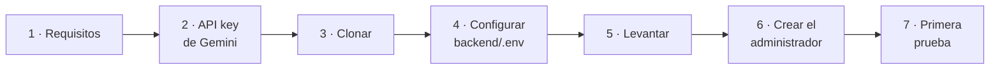

# Instalación paso a paso

[← Volver al README](../README.md)

Esta guía levanta el servicio completo en tu computador con Docker, aunque nunca hayas visto el proyecto. Al terminar tendrás la aplicación en **http://localhost:8000**, un administrador creado y un primer cliente que ya puede extraer un cuestionario.

**Tiempo estimado:** 20 a 30 minutos. La mayor parte es la primera construcción de las imágenes.



> Para **modificar el código** usa la [guía de desarrollo](desarrollo.md). Para publicar cambios en **producción (Google Cloud)**, usa la [guía de despliegue](despliegue.md); para instalarlo en un **servidor propio con dominio**, sigue primero esta guía y luego la de [servidor propio](servidor-propio.md).

---

## 1. Requisitos

| Necesitas | Para qué | Cómo comprobarlo |
|---|---|---|
| **Git** | Descargar el código | `git --version` |
| **Docker** con **Compose v2** | Construir y ejecutar el servicio | `docker compose version` (debe decir `v2.x` o superior) |
| ~3 GB libres en disco | Las imágenes (el backend incluye LibreOffice, ~1,3 GB) | |
| Conexión a internet | Descargar dependencias y llamar a los modelos | |

Si te falta Docker:

- **Windows o macOS:** instala [Docker Desktop](https://docs.docker.com/desktop/) y ábrelo. En Windows, déjalo usar WSL 2 (es la opción por defecto).
- **Linux:** instala [Docker Engine](https://docs.docker.com/engine/install/) y el plugin de Compose. En Ubuntu o Debian, el script oficial instala ambos: `curl -fsSL https://get.docker.com | sh`.

Comprueba que Docker funciona:

```bash
docker run --rm hello-world
```

Si imprime `Hello from Docker!`, estás listo.

> Todos los comandos de esta guía se escriben en una terminal: **PowerShell** en Windows, **Terminal** en macOS o Linux.

## 2. Consigue una API key de Gemini

El servicio usa un modelo de lenguaje para leer los cuestionarios. **Gemini es obligatorio**; OpenAI y DeepSeek son opcionales.

1. Entra a [Google AI Studio → API keys](https://aistudio.google.com/apikey) con una cuenta de Google y pulsa **Create API key**.
2. Copia la key y guárdala; la usarás en el paso 4.
3. **Activa la facturación** del proyecto de esa key. En el plan gratuito las cuotas son muy bajas y Google puede usar los documentos para entrenar sus modelos.
4. Revisa el **límite de gasto mensual** en [ai.studio/spend](https://ai.studio/spend). Si se alcanza, el servicio responde "Se agotó la cuota del modelo".

**Opcional:** con una key de [OpenAI](https://platform.openai.com/api-keys) o de [DeepSeek](https://platform.deepseek.com/api_keys), sus modelos aparecen en la página y los clientes pueden comparar resultados. Cada una requiere una cuenta con saldo en ese proveedor.

## 3. Descarga el código

```bash
git clone <url-del-repositorio> giunti
cd giunti
```

Desde ahora, todos los comandos se ejecutan dentro de la carpeta `giunti`.

## 4. Configura el backend

**4.1.** Crea tu archivo de configuración a partir de la plantilla:

```bash
cp backend/.env.example backend/.env
```

**4.2.** Genera un secreto aleatorio. Protege las claves de los clientes:

```bash
docker run --rm python:3.13-slim python -c "import secrets; print(secrets.token_urlsafe(48))"
```

Imprime una línea de 64 caracteres, por ejemplo `kQ3v…Zx8w`. Cópiala.

**4.3.** Abre `backend/.env` con cualquier editor de texto (VS Code, Bloc de notas, `nano backend/.env`…) y busca estas dos líneas, que ya existen. Reemplaza lo que está después del `=`:

```ini
GEMINI_API_KEY=<la key de Gemini del paso 2>
API_KEY_PEPPER=<el secreto del paso 4.2>
```

Pega los valores tal cual, sin comillas ni espacios. Por ejemplo:

```ini
API_KEY_PEPPER=kQ3vN0x…Zx8w
```

Si tienes keys de OpenAI o DeepSeek, agrégalas en la línea `LLM_API_KEYS` (deja vacía la que no tengas):

```ini
LLM_API_KEYS={"openai": "sk-…", "deepseek": "sk-…"}
```

No cambies nada más: el resto de las variables ya tiene valores que funcionan, y cada una está explicada en el mismo archivo.

> **Importante:** guarda `API_KEY_PEPPER` en un lugar seguro. Si cambia, todas las claves de los clientes dejan de funcionar. `backend/.env` tiene secretos: git lo ignora y no se debe compartir.

## 5. Levanta el servicio

```bash
docker compose up -d --build
```

La primera vez tarda entre 5 y 15 minutos, según tu conexión: descarga las imágenes base, instala LibreOffice y las dependencias, y construye la página. Las siguientes veces arranca en segundos.

Comprueba que los dos servicios están sanos. Si dicen `starting`, espera 30 segundos y repite:

```bash
docker compose ps
```

Debes ver algo así (se muestran solo las columnas importantes):

```
NAME                STATUS
giunti-backend-1    Up 1 minute (healthy)
giunti-frontend-1   Up 40 seconds (healthy)
```

Abre **http://localhost:8000**: debe aparecer la página "Extrae las preguntas de tu cuestionario", que pide una clave de acceso. Esa clave se crea en los pasos siguientes.

> **¿El puerto 8000 está ocupado?** Crea un archivo `.env` en la carpeta `giunti` (junto a `docker-compose.yml`, **no** dentro de `backend/`) con la línea `APP_PORT=8001` y vuelve a ejecutar `docker compose up -d`. La aplicación quedará en http://localhost:8001.

## 6. Crea el administrador

Ejecútalo **una sola vez**:

```bash
docker compose exec backend python -m app.auth.create_key --name "Administración" --admin
```

```
Administrator 'Administración' created (id: administracion).

Invitation link (sign-in with one click):
http://localhost:8000/admin#clave=gk_administracion_…

API key (shown only once):
gk_administracion_…
```

Abre el **enlace** en el navegador: entras directo al panel de administración, y el navegador lo recuerda para las próximas visitas.

> **Importante:** El enlace **no se vuelve a mostrar**. Guárdalo en un gestor de contraseñas. Si lo pierdes, ejecuta el comando otra vez: crea un administrador nuevo.

## 7. Haz la primera prueba

1. En el panel, en **Nuevo cliente**, escribe un nombre (por ejemplo, "Prueba") y pulsa **Crear invitación**.
2. Pulsa **Copiar enlace** y ábrelo en otra pestaña: entras a la página de los clientes con ese cliente.
3. Arrastra un cuestionario (PDF, Word o Excel), deja el modelo **Recomendado** y pulsa **Extraer preguntas**.
4. Espera entre 1 y 3 minutos. Verás las preguntas como tarjetas, y con un botón puedes cambiar a la vista JSON para copiarlo o descargarlo.

**¡Listo!** El servicio funciona. Para saber qué más se puede hacer, lee la [guía de uso](uso.md).

## Detener, volver a levantar y actualizar

| Para | Comando |
|---|---|
| Detener | `docker compose down` (los clientes y sus claves se conservan) |
| Volver a levantar | `docker compose up -d` |
| Aplicar cambios de `backend/.env` | `docker compose up -d --force-recreate backend` |
| Actualizar a una versión nueva del código | `git pull && docker compose up -d --build` |
| Ver los logs del backend | `docker compose logs -f backend` (Ctrl+C para salir) |

> **Importante:** `docker compose down -v` (con `-v`) **borra la base de datos** de clientes y claves.

¿Algo no funcionó? Revisa [problemas frecuentes](problemas.md).
