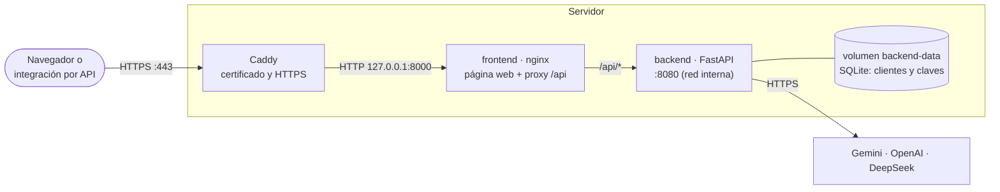

# Despliegue en un servidor propio

[← Volver al README](../README.md) · [Despliegue en Google Cloud (producción actual)](despliegue.md)

Alternativa a la [producción en Google Cloud](despliegue.md), para instalar el servicio en un servidor propio o en la infraestructura de un cliente. Esta guía lo publica en un dominio propio con HTTPS, por ejemplo `https://cuestionarios.tu-dominio.com`. Usa Docker Compose en un solo servidor y Caddy delante para los certificados.

> Conviene haber seguido antes la [guía de instalación](instalacion.md) en tu computador: el procedimiento es el mismo, con tres pasos más (dominio, proxy con HTTPS y respaldos).

## Cómo queda montado



- Solo Caddy queda expuesto a internet (puertos 80 y 443).
- El puerto 8000 escucha únicamente en la propia máquina (`APP_BIND_ADDRESS=127.0.0.1`), así que nadie puede entrar por HTTP saltándose el HTTPS.
- El backend no publica ningún puerto: solo lo alcanza el nginx del frontend.
- Los documentos se procesan en memoria y se descartan. Solo persisten los clientes y sus claves (como hash), en el volumen `backend-data`.

## Requisitos

| Recurso | Recomendado |
|---|---|
| Servidor | Linux (Ubuntu 22.04/24.04 o Debian 12) con acceso SSH y `sudo` |
| CPU y memoria | 2 vCPU y 4 GB de RAM. Leer un Word abre LibreOffice, y los documentos largos se procesan en 4 partes a la vez |
| Disco | 10 GB libres |
| Dominio | Un nombre (por ejemplo, `cuestionarios.tu-dominio.com`) cuyo DNS puedas editar |
| Red | Puertos 80 y 443 abiertos hacia internet, y salida HTTPS hacia los proveedores de modelos |

## 1. Apunta el dominio al servidor

En el panel DNS de tu dominio, crea un registro **A** (y **AAAA** si el servidor tiene IPv6) con el nombre elegido y la IP pública del servidor.

> **Cloudflare:** deja el registro como **solo DNS** (nube gris). Con el proxy de Cloudflare activado (nube naranja), toda petición que tarde más de 100 segundos se corta, y una extracción puede tardar más de 10 minutos.

## 2. Prepara el servidor

Conéctate por SSH e instala Docker con el script oficial, que incluye Compose:

```bash
curl -fsSL https://get.docker.com | sudo sh
sudo usermod -aG docker $USER     # para usar docker sin sudo; cierra la sesión SSH y vuelve a entrar
docker compose version            # comprueba que responde v2.x o superior
```

Si usas el firewall `ufw`, deja pasar solo SSH y la web:

```bash
sudo ufw allow OpenSSH
sudo ufw allow 80,443/tcp
sudo ufw enable
```

## 3. Descarga y configura el servicio

```bash
git clone <url-del-repositorio> giunti
cd giunti
cp backend/.env.example backend/.env
```

**3.1. `backend/.env`:** complétalo igual que en el [paso 4 de la instalación](instalacion.md#4-configura-el-backend): `GEMINI_API_KEY`, `API_KEY_PEPPER` y, si las tienes, `LLM_API_KEYS`. Si ya tienes un `backend/.env` que funciona en tu computador, puedes copiarlo desde tu equipo:

```bash
scp backend/.env usuario@servidor:~/giunti/backend/.env
```

En el servidor, cambia además `CORS_ORIGINS` por `CORS_ORIGINS=[]`: la página y la API comparten dirección, así que ningún otro sitio necesita acceso.

> Docker Compose arranca el backend siempre en **modo producción** (`APP_ENV=production`): si `API_KEY_PEPPER` es el de ejemplo o tiene menos de 32 caracteres, el backend no arranca.

**3.2. `.env` en la raíz** (junto a `docker-compose.yml`). Créalo con `nano .env`:

```ini
# Puerto de la aplicación en esta máquina; Caddy apunta aquí.
APP_PORT=8000
# Solo los programas de este servidor (Caddy) llegan a ese puerto.
APP_BIND_ADDRESS=127.0.0.1
# Dirección pública que abre la gente. Va en los enlaces de invitación.
PUBLIC_APP_URL=https://cuestionarios.tu-dominio.com
```

> **Importante:** `PUBLIC_APP_URL` debe ser la dirección real con `https://`. Si no, los enlaces de invitación llevarán a `http://localhost:8000` y no funcionarán.

Protege ambos archivos, porque tienen secretos:

```bash
chmod 600 .env backend/.env
```

## 4. Levanta el servicio

```bash
docker compose up -d --build
docker compose ps                 # espera a que ambos digan (healthy)
```

## 5. Pon HTTPS con Caddy

Caddy obtiene y renueva el certificado solo, y no corta las respuestas largas.

1. Instálalo siguiendo la [guía oficial para Debian/Ubuntu](https://caddyserver.com/docs/install#debian-ubuntu-raspbian).
2. Reemplaza el contenido de `/etc/caddy/Caddyfile` por:
   ```
   cuestionarios.tu-dominio.com {
       reverse_proxy 127.0.0.1:8000
   }
   ```
3. Aplica el cambio:
   ```bash
   sudo systemctl reload caddy
   ```
4. Abre `https://cuestionarios.tu-dominio.com`: debe cargar la página con el candado de HTTPS. El primer acceso puede tardar unos segundos mientras Caddy obtiene el certificado.

<details>
<summary><b>¿Usas otro proxy en vez de Caddy?</b></summary>

Una extracción puede tardar **más de 10 minutos** y los archivos llegan a 20 MB. El proxy debe aceptar ambas cosas; si no, el usuario ve un error a los 60 o 100 segundos aunque el servicio siga trabajando.

- **nginx:** en el `location /` que apunta a `http://127.0.0.1:8000`, agrega:
  ```nginx
  client_max_body_size 25m;
  proxy_read_timeout 900s;
  proxy_send_timeout 900s;
  ```
- **Traefik:** en el entrypoint de HTTPS, sube `transport.respondingTimeouts.readTimeout` a `900s` (por defecto corta a los 60 segundos).
- **Balanceador de un proveedor de nube:** sube su tiempo de espera (*idle timeout*) a 900 segundos. Si el balanceador está en otra máquina, usa `APP_BIND_ADDRESS=0.0.0.0` y limita el puerto 8000 con el firewall del proveedor.
- **Cloudflare con proxy activado:** no es compatible, porque corta a los 100 segundos.

</details>

## 6. Crea el administrador

```bash
docker compose exec backend python -m app.auth.create_key --name "Administración" --admin
```

El enlace que imprime ya usa tu dominio (`https://cuestionarios.tu-dominio.com/admin#clave=gk_…`). Ábrelo, guárdalo en un lugar seguro y crea los clientes desde el panel, como se explica en la [guía de uso](uso.md).

## Mantenimiento

| Para | Comando (en la carpeta `giunti`) |
|---|---|
| Ver si está funcionando | `docker compose ps` (ambos `healthy`) |
| Ver los logs | `docker compose logs -f backend` |
| Aplicar cambios de `backend/.env` | `docker compose up -d --force-recreate backend` |
| Aplicar cambios del `.env` de la raíz | `docker compose up -d` |
| Actualizar a una versión nueva | `git pull && docker compose up -d --build` |
| Reiniciar | `docker compose restart` |
| Detener | `docker compose down` (los clientes y sus claves se conservan) |

Los servicios se reinician solos si fallan o si el servidor se reinicia (`restart: unless-stopped`). Los logs rotan solos: 5 archivos de 10 MB por servicio.

### Respaldos

Los clientes y sus claves viven en el volumen `backend-data`. `docker compose down -v` **los borra**.

| Para | Comando |
|---|---|
| Respaldar ahora | `docker compose cp backend:/app/data/giunti.db ./respaldo-giunti.db` |
| Restaurar un respaldo | Los tres comandos de abajo |

```bash
docker compose cp ./respaldo-giunti.db backend:/app/data/giunti.db
docker compose exec -u root backend chown appuser /app/data/giunti.db   # el backend debe poder escribirlo
docker compose restart backend
```

Para respaldar todos los días a las 3:00, crea la carpeta `respaldos` dentro de `giunti` y agrega esta línea con `crontab -e` (cambia la ruta):

```bash
0 3 * * * cd /home/usuario/giunti && docker compose cp backend:/app/data/giunti.db respaldos/giunti-$(date +\%F).db
```

> Un respaldo solo sirve con el mismo `API_KEY_PEPPER` con que se creó: guarda los dos juntos, fuera del servidor.

### Lista de verificación final

- [ ] `https://tu-dominio` carga con candado, y `http://tu-dominio` redirige a HTTPS (Caddy lo hace solo).
- [ ] `http://IP-del-servidor:8000` **no** responde desde fuera del servidor.
- [ ] `docker compose ps` muestra ambos servicios `healthy`.
- [ ] El enlace del administrador usa el dominio y abre el panel.
- [ ] Un cuestionario largo (más de 20 páginas) se extrae sin cortarse.
- [ ] El respaldo diario aparece en `respaldos/` al día siguiente.

¿Algo falló? Revisa [problemas frecuentes](problemas.md).
