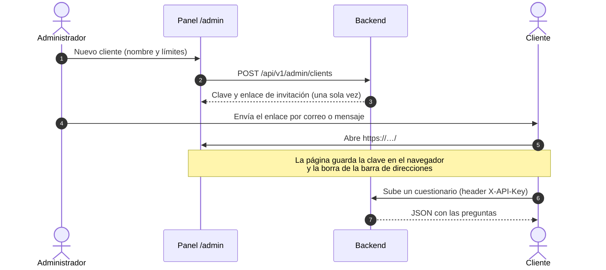

# Uso

[← Volver al README](../README.md)

Hay dos tipos de acceso, y los dos entran con un **enlace de invitación** en vez de usuario y contraseña:

| Rol | Entra en | Puede |
|---|---|---|
| **Administrador** | `/admin` | Crear clientes, enviarles su invitación, fijar sus límites, desactivarlos, reactivarlos y eliminarlos |
| **Cliente** | `/` | Extraer cuestionarios desde la página o por API, dentro de sus límites |

## Cómo llega un cliente al servicio



## Panel de administración

El primer administrador se crea desde la terminal; el comando está en la [instalación](instalacion.md#6-crea-el-administrador). Los administradores nunca se crean ni se eliminan desde la web. Para eliminar uno (por ejemplo, el de un enlace perdido), usa el comando de la terminal con su id:

```bash
docker compose exec backend python -m app.auth.delete_client administracion   # con Docker Compose
just backend::delete-key administracion                                        # en desarrollo
```

**Crear un cliente**

1. En **Nuevo cliente**, escribe su nombre (por ejemplo, "Colegio San José") y cuántas extracciones puede hacer **por día** y **por minuto**. Por defecto son 100 y 10.
2. Pulsa **Crear invitación**.
3. Pulsa **Copiar enlace** y envíaselo por correo o mensaje. Debajo, en **Ver la clave (para integraciones por API)**, está la clave para usar la API directamente.

> **Importante:** El enlace y la clave **se muestran una sola vez**: el servidor solo guarda un hash. Si se pierden, usa **Nueva invitación** en la tarjeta del cliente.

**Administrar los clientes.** Cada cliente aparece en una tarjeta con su uso de hoy y su último acceso. Desde ahí puedes:

| Acción | Efecto |
|---|---|
| **Editar límites** | Cambia las extracciones permitidas por día y por minuto. Aplica de inmediato |
| **Desactivar** / **Activar** | Bloquea o devuelve el acceso sin borrar al cliente |
| **Nueva invitación** | Genera otra clave y otro enlace. **El anterior deja de funcionar** al instante |
| **Eliminar** | Borra el cliente, su clave y su historial de uso. Su enlace deja de funcionar al instante y **no se puede deshacer** |

Los contadores diarios se reinician a las 00:00 UTC. Cada extracción solicitada cuenta, incluso si falla, porque protege el gasto en modelos.

## Página de los clientes

1. **Entrar:** abrir el enlace de invitación. El navegador recuerda la clave; no hay que escribirla.
2. **Elegir el archivo:** arrastrarlo o seleccionarlo. Acepta PDF, Word (`.docx`) y Excel (`.xlsx`) de hasta 20 MB y 60 páginas.
3. **Elegir el modelo y el modo:** el modelo marcado como **Recomendado** sirve para la mayoría de los casos. Solo aparecen los modelos cuyo proveedor tiene API key configurada. Si el modelo lo permite, debajo se elige el **modo de lectura**:
   - **Rápido** (por defecto): el modelo razona lo justo. Tarda segundos o un par de minutos y consume mucho menos.
   - **Preciso**: el modelo razona más antes de responder. Úsalo con documentos difíciles (escaneados, con figuras o con la clave de respuestas en imagen) o si el modo rápido dejó dudas. Puede tardar varios minutos y cuesta varias veces más.
4. **Extraer preguntas:** suele tardar entre 1 y 3 minutos; un documento largo, más. Mientras espera, la página muestra el tiempo transcurrido y se puede **Cancelar**.
5. **Revisar:** cada pregunta aparece como tarjeta, con la respuesta correcta resaltada. Las **advertencias** señalan lo que no se pudo verificar contra el documento. Con un botón se cambia a la vista **JSON**, para copiarlo o descargarlo.
6. **Comparar:** **Probar con otro modelo** vuelve a la elección de modelo y modo, sin volver a subir el archivo. El resumen del resultado indica qué modelo y qué modo se usaron.

Los archivos se procesan en memoria y se descartan: el servidor no guarda documentos ni resultados.

## Integración por API

La documentación interactiva (OpenAPI) está en `/docs` del backend: http://localhost:8080/docs en desarrollo. Con Docker Compose, el backend no publica su puerto: la API se usa a través de la misma dirección de la página, bajo `/api` (por ejemplo, `http://localhost:8000/api/v1/...`).

Todas las rutas de `/api/v1` exigen la clave del cliente en el header **`X-API-Key`**.

### Extraer un cuestionario

```bash
curl -H "X-API-Key: gk_colegio-san-jose_…" \
  -F file=@cuestionario.pdf \
  -F model=gemini-flash \
  http://localhost:8000/api/v1/questionnaires
```

`model` es opcional: sin él se usa el modelo por defecto. Sus valores posibles son los `id` que devuelve `GET /api/v1/models`.

`mode` también es opcional: `fast` (rápido) o `precise` (preciso). Sin él se usa el `default_mode` del catálogo. `GET /api/v1/models` indica en `modes` cuáles ofrece cada modelo. Si un modelo no ofrece `fast`, se usa `precise`, y el header `X-LLM-Mode` informa el modo que realmente corrió. Por ejemplo, para el modo preciso agrega `-F mode=precise`. Para ver además los headers de la respuesta, agrega `-i` a `curl`. Usa un tiempo de espera de al menos 15 minutos en tu cliente HTTP: los documentos largos tardan.

### Endpoints

| Endpoint | Qué hace |
|---|---|
| `GET /api/v1/models` | Modelos disponibles agrupados por proveedor, con su descripción, los modos que ofrece cada uno (`modes`), el modelo por defecto y el modo por defecto (`default_mode`). Solo aparecen los modelos cuyo proveedor tiene API key configurada. No consume cuota. |
| `POST /api/v1/questionnaires` | Recibe un archivo (`file`, multipart) y opcionalmente el modelo (`model`, un `id` de `GET /models`). Devuelve el JSON del cuestionario. Consume una unidad de la cuota diaria del cliente. |
| `/api/v1/admin/clients` | Panel de administración: listar, crear (`POST`), editar (`PATCH /{id}`: nombre, límites, activar/desactivar), reemplazar la clave (`POST /{id}/key`) y eliminar (`DELETE /{id}`, salvo administradores). Solo con clave de administrador. |
| `GET /health` | Estado del servicio (sin autenticación). Solo en el backend: nginx no lo publica. |

### Headers de la respuesta

La respuesta del `POST` incluye headers con datos de la ejecución:

| Header | Contenido |
|---|---|
| `X-LLM-Model` | Modelo que produjo el resultado |
| `X-LLM-Mode` | Modo de razonamiento que se usó: `fast` o `precise` |
| `X-LLM-Input-Tokens` / `X-LLM-Output-Tokens` | Tokens consumidos, sumando todas las llamadas |
| `X-LLM-Repairs` | Cuántas veces se pidió al modelo corregir su respuesta |
| `X-LLM-Duration-Ms` | Tiempo total en el modelo |
| `X-Extraction-Parts` | En cuántas partes se procesó un documento largo |
| `X-Extraction-Warnings` | Advertencias (ver abajo) |
| `X-RateLimit-Limit-Day` / `X-RateLimit-Remaining-Day` | Cuota diaria del cliente y lo que le queda hoy |
| `X-Request-ID` | Identificador de la petición, el mismo que aparece en los logs |

`X-Extraction-Warnings` es una lista JSON de objetos `{"code", "message", "items", "pages"}`: contenido que no se pudo verificar contra el documento, páginas escaneadas, respuestas que la clave no indica, etc. `items` usa la numeración final del cuestionario. Códigos: `scanned_pages`, `missing_formula_values`, `statement_not_found`, `options_not_found`, `answer_not_verified`, `missing_item_numbers`, `answer_key_unread`, `answers_not_in_key`.

### Errores

Los errores siguen el formato `{"error": {"code", "message", "request_id", "reason", "details"}}`. `reason` y `details` solo aparecen cuando un mismo código cubre situaciones que piden acciones distintas:
- `reason` dice el motivo, por ejemplo `too_many_pages`, `quota_exhausted`, `model_paused`, `per_minute_limit` o `daily_limit`. La lista completa está en `ErrorReason` (`backend/app/core/errors.py`).
- `details` trae los datos para el mensaje, como `{"limit": 60, "actual": 63}` o `{"model": "gemini-flash"}`.

`Retry-After` indica cuántos segundos esperar en estos casos:
- `429 RATE_LIMITED`;
- `502 LLM_UNAVAILABLE` cuando el modelo agotó su cuota o quedó en pausa.

| HTTP | `code` | Cuándo |
|---|---|---|
| 401 | `UNAUTHENTICATED` | Falta la clave o no es válida |
| 403 | `FORBIDDEN` | El cliente está desactivado, o no es administrador y entra al panel |
| 404 | `NOT_FOUND` | La ruta o el cliente no existen |
| 413 | `FILE_TOO_LARGE` | El archivo supera `MAX_FILE_SIZE_MB` |
| 415 | `UNSUPPORTED_FORMAT` | No es PDF, DOCX ni XLSX, o es un formato antiguo o con macros |
| 422 | `INVALID_FILE` · `EMPTY_FILE` · `PROTECTED_FILE` · `NO_TEXT` | El archivo está dañado, vacío, protegido con contraseña o sin contenido legible |
| 422 | `NO_ITEMS` | El documento no parece un cuestionario |
| 422 | `INVALID_REQUEST` | Datos inválidos, por ejemplo un modelo que no existe o sin API key |
| 429 | `RATE_LIMITED` | Se superó el límite por minuto o el diario |
| 500 | `INTERNAL_ERROR` | Error inesperado; el `request_id` permite encontrarlo en los logs |
| 502 | `LLM_UNAVAILABLE` · `INVALID_LLM_RESPONSE` | El modelo falló, agotó su cuota o respondió algo inutilizable |
| 503 | `NO_MODELS_AVAILABLE` | Ningún proveedor tiene API key configurada |
